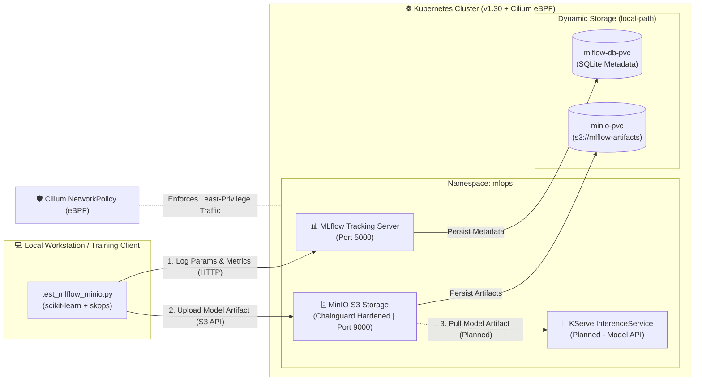

# Zero-Trust MLOps Platform on Kubernetes

A security-first, production-aligned MLOps platform built on Kubernetes with **Cilium eBPF**, **Chainguard Hardened Images**, **MinIO**, and **MLflow**.

Designed as a local cloud-parity lab to validate end-to-end machine learning lifecycle workflows—from experiment tracking and safe model serialization to zero-trust network isolation—before migrating to **AWS EKS**.

---

## 🏗️ Architecture & Data Flow

The platform separates **Metadata Control Plane** operations from **Model Artifact Data Plane** transfers, strictly simulating an AWS EKS + S3 architecture locally.



---

## 🧩 Core Components

**Storage Layer (MinIO + local-path-provisioner)**
Acts as a 100% S3-compatible object store (`s3://mlflow-artifacts`). Runs on `cgr.dev/chainguard/minio:latest`, a distroless, zero-CVE hardened container image to minimize the attack surface.

**Experiment Tracking & Registry (MLflow)**
Tracks training parameters, evaluation metrics, Git commit provenance, and artifact URIs backed by persistent block storage.

**Safe Model Serialization (skops)**
Uses `skops.io` instead of standard Python pickle to prevent arbitrary code execution (deserialization attacks) when loading model artifacts.

**Network Security (Cilium eBPF)**
Provides kernel-level networking and observability (Hubble), preparing the cluster for strict Default-Deny and L3/L4/L7 zero-trust policies.

---

## ☁️ Local Lab to AWS EKS Parity

Every component in this repository maps directly to managed AWS services for seamless cloud migration and **AWS Certified Security - Specialty (SCS-C03)** architectural alignment:

| Layer | Local Kubernetes Lab | AWS EKS Production Equivalent | Security & Architecture Notes |
|---|---|---|---|
| Compute & CNI | kubeadm (v1.30) + Cilium eBPF | Amazon EKS + Cilium CNI | Kernel-level network enforcement & Hubble flow visibility |
| Artifact Store | MinIO (`cgr.dev/chainguard/minio`) | Amazon S3 | Bucket policies, Versioning, and SSE-KMS encryption |
| Authentication | Kubernetes Secret (`minio-creds`) | IRSA (IAM Roles for Service Accounts) | Eliminates static long-lived credentials inside pods |
| Metadata DB | SQLite on local-path PVC | Amazon RDS (PostgreSQL) | Automated backups, Multi-AZ, and encrypted storage |
| Model Serving | KServe (RawDeployment) | KServe on EKS / Amazon SageMaker | Isolated inference endpoints with strict egress rules |

> [!CAUTION]
> Static credentials in `manifests/03-mlops-core/mlops-core.yaml` are strictly for local cluster simulation. In production on AWS EKS, authentication is handled via short-lived STS tokens using **IRSA**.

---

## 📂 Repository Structure

```
.
├── docs/                           # Architecture diagrams & Hubble observability captures
├── manifests/
│   └── 03-mlops-core/
│       └── mlops-core.yaml         # Namespace, Secrets, PVCs, MinIO, Bucket Job, & MLflow
├── scripts/
│   └── test_mlflow_minio.py        # Smoke test script (trains model & pushes to MLflow/MinIO)
└── README.md
```

---

## 🚀 Quickstart & Verification

### 1. Deploy Core MLOps Stack

Apply the core manifests to provision storage, MinIO, the `mlflow-artifacts` bucket, and the MLflow server:

```bash
kubectl apply -f manifests/03-mlops-core/mlops-core.yaml
kubectl get pods,pvc -n mlops
```

### 2. Expose Services Locally

Forward the MLflow UI (5000) and MinIO S3 API (9000) ports to your local workstation:

```bash
kubectl port-forward -n mlops svc/mlflow 5000:5000 &
kubectl port-forward -n mlops svc/minio 9000:9000 &
```

### 3. Run End-to-End Smoke Test

Execute the training smoke test inside a Python virtual environment to verify metadata logging and S3 artifact persistence:

```bash
python3 -m venv .venv
source .venv/bin/activate
pip install mlflow-skinny boto3 scikit-learn pandas skops

python scripts/test_mlflow_minio.py
```

Verify the run at <http://localhost:5000> under the `cilium-lab-smoke-test` experiment and confirm that `MLmodel` and `model.skops` appear under the **Artifacts** tab.

---

## 🗺️ Project Roadmap

- [x] **Phase 1:** Dynamic Storage & Core MLOps Stack _(local-path StorageClass, MinIO S3, MLflow Tracking)_
- [x] **Phase 2:** Supply Chain Hardening & Smoke Testing _(Migrated to Chainguard distroless MinIO image; validated skops artifact pipeline)_
- [ ] **Phase 3:** Model Inference Serving _(Deploy KServe in RawDeployment mode to serve `s3://mlflow-artifacts` via REST API)_
- [ ] **Phase 4:** Zero-Trust Network Enforcement _(Apply CiliumNetworkPolicy Default-Deny + least-privilege rules & verify via Hubble)_
- [ ] **Phase 5:** Cloud Migration (AWS EKS) _(Terraform IaC for EKS, S3, RDS, and IRSA)_
